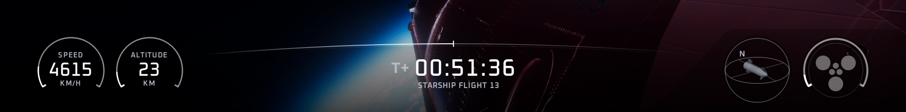
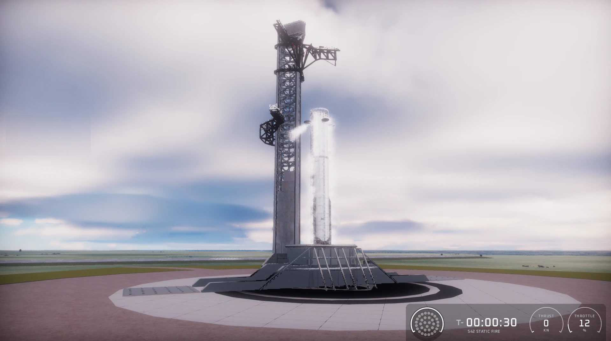
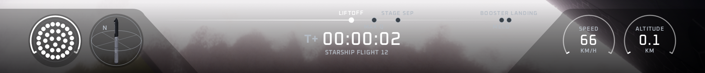
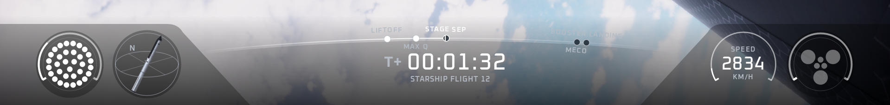
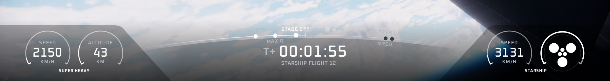
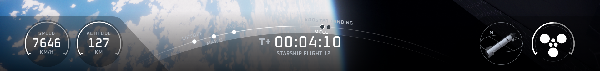

# KSP Starship Telemetry

**Need help or want to ask a question?** Join the Discord at https://discord.gg/kvCDvAHWtm and either DM Astra or mention him in the general channel.

A Starship-webcast-style telemetry overlay for Kerbal Space Program, made for the **Starship Expansion Project** Starship on its Super Heavy booster. It only reads from the game through [kRPC](https://krpc.github.io/krpc/): nothing here sends a flight command.

**It does not work with other rockets.** It is built for that one Starship and Super Heavy (the engine dial, separation detection, flaps and 3D model all assume them), so it will not give sensible readings on any other craft.

**To start it, run this one file:**

```bash
pip install -r requirements.txt
python run_ground_station.py
```

(Start the kRPC server in KSP first. Full steps in [Quick start](#quick-start).)

> **Beta, made with Claude.** Early version, built by directing Claude (Anthropic's AI assistant) and tested in the game by the author: it works in real launches and static fires, but expect rough edges.<br>
> **Using it in a video or live stream?** Please credit **astraspac2** and link this project if you can.<br>
> **Found a problem?** Join the Discord <https://discord.gg/kvCDvAHWtm>, then DM Astra or mention him in the general channel.



## What it does

- **Launch bar:** countdown clock, curved timeline, engine dots with a propellant ring, a 3D dial with the Starship on its booster, speed and altitude. It switches layout through stage 1, stage separation and flight, and the real separation is detected from the data.
- **Timeline:** milestones scroll past the clock and the line bows with altitude. Add your own events and notes.
- **Moving flaps:** the four flaps of the ship in the 3D dial follow the real ones: deploy and retract, each flap's own deploy angle (it changes on the landing burn) and pitch, roll and yaw input.
- **Re-entry glow:** the ship's heat shield glows red, orange and white-hot in the 3D dial while it comes down, with a halo and small flickers. **The re-entry glow is still a work in progress**: when it starts and ends, and how it looks, will still change.
- **Automatic markers:** plan a maneuver node in KSP and you are asked to name it. A RE-ENTRY marker is set when the ship comes down through 70 km (it arms once the ship has been above 30 km), and a LANDING BURN marker predicts the burn and is set at 800 m (it arms once the ship has been above 50 km). Both show from T+00:10:00.
- **One overlay window:** the pill and the bar are parts of a single window, so capture software sees only one.
- **Static-fire bar:** a small bar for the pad with engines, clock, thrust and throttle, in the bottom-right corner.
- **Map:** a black-and-white Earth with your position instead of the engine dial.
- **Honest data:** mock data is always labelled MOCK, and a lost or stale feed says so.


## Screenshots



<details>
<summary>The flight bar from liftoff to space (4 pictures)</summary>

**Liftoff**, T+00:00:02: engine dial, 3D dial, speed and altitude.



**Max Q**, T+00:01:32: the Starship on its Super Heavy in the 3D dial, the curved timeline bowing with altitude.



**Stage separation**, T+00:01:55: the SUPER HEAVY / STARSHIP layout, each with its own speed and engine dial.



**In space**, T+00:04:10: the ship alone in the 3D dial after the booster is gone.



</details>

## Quick start

1. **Install the mods** from the list below, then copy [`craft/Starship V3.craft`](craft/Starship%20V3.craft) into `saves/<your save>/Ships/VAB/`. The overlay was built and tested with this craft, so it should work best.
2. **Start the kRPC server** in KSP (accept its "allow connection" prompt if it shows). It must be kRPC **0.6.0 exactly**, see below.
3. **Run it:** `pip install -r requirements.txt`, then `python run_ground_station.py`. It connects by itself and keeps retrying until the server is up.

No game at hand? In the **Data & Test** tab pick mock data to watch a made-up flight.

Needs Windows (the only system it has been run on), Python 3.11+ and KSP 1.12.x.

## Mods you need

| Mod | Why |
|---|---|
| [kRPC **0.6.0 (exactly this version)**](https://github.com/krpc/krpc/releases/tag/v0.6.0) | The data comes from it. Download `krpc-0.6.0.zip` from the link. **It does not work with newer versions yet:** the latest release (0.7.0) fails to connect, so use this older one. `requirements.txt` pins the matching Python package. |
| [Starship Expansion Project 3.3.2](https://github.com/Kari1407/Starship-Expansion-Project/releases/tag/v3.3.2) | The Starship and Super Heavy this is made for (not for other rockets). |
| [Starship Launch Expansion](https://forum.kerbalspaceprogram.com/index.php?/topic/203952-1122-starship-launch-expansion/) | The tower and catching arms. |
| [Starship Pad Modernization](https://spacedock.info/mod/3924/Starship%20Pad%20Modernization) | The Pad-B/2 launch pad. Needs B9PartSwitch and ModuleManager; recommends Vessel Mover, KKStatics and Hangar Extender. |
| [F3's GSE](https://spacedock.info/mod/4025/F3%27s%20GSE) | Ground equipment for Starship Pad B, made for the Starship Expansion Project Block 3. Needs ModuleManager, B9PartSwitch, Kerbal Konstructs, Resurfaced, Shabby and Textures Unlimited (keep it up to date); recommends TUFX and Hangar Extender. |

<details>
<summary>The Starship Expansion Project's own dependencies</summary>

Required: ModuleManager, CommunityResourcePack, B9PartSwitch, Waterfall, KSPCommunityPartModules, KSPCommunityFixes, Harmony 2 and Shabby.
Recommended: KerbalJointReinforcementContinued, FlyByWireSASMode and MechJeb2. (From its CKAN file.)

</details>

**Status says "kRPC version mismatch" (or "ValueError: Invalid type")?** The kRPC mod in your KSP is not version 0.6.0, most often the newest release (0.7.0), which does not work with this app. Download the **older** kRPC 0.6.0 from the link above and replace the newer one; the Python package is already pinned to 0.6.0 by `pip install -r requirements.txt`.

The map assumes Earth: it plots your latitude and longitude on a map of Earth, so it needs an Earth-like planet pack. **If you want to use the map, I recommend Sol Quarter Scale** (a quarter-scale real solar system). On stock Kerbin, leave the map off.

## Using it

The pill and bar share one overlay window, `KSP Starship Telemetry - Overlay`: it is as big as your screen, transparent where nothing is drawn, click-through and always on top by default. The control panel is a normal window. Settings are saved in `%APPDATA%\KSP Starship Telemetry\settings.json`; next to it the app writes `flap-trace.csv` and `booster-loss.csv`, records of what the game reported about the flaps and the lost booster.

**In OBS:** add one Window Capture source, pick `KSP Starship Telemetry - Overlay`, set the Capture Method to "Windows 10 (1903 and up)" (the other methods show the transparent parts as black) and stretch it over the whole scene. For chroma key, pick the solid colour background: the whole overlay window gets that colour.

| Where | What |
|---|---|
| HUD tab, "Bar for" (key `P`) | Switch between the flight bar and the small static-fire bar |
| Key `M` | Map instead of the engine dial (flight bar) |
| Mission & Timeline tab | Countdown, your events, the automatic markers (hide, rename or delete) |
| Markers tab | Stamp a typed note at the current time |
| HUD tab, Screen resolution | Scale the whole HUD to your monitor (automatic by default) |
| HUD tab, side panels | Show or hide the bar's side panels; they sink away and rise again like the first rise |
| HUD tab, flaps and re-entry glow | Turn the flaps' roll and yaw movement, and the re-entry glow, on or off |
| HUD tab, 3D model | Use your own `.glb`, `.gltf`, `.obj` or `.stl` instead of the built-in Starship, and untick click-through to drag the windows |
| Broadcast lock | Locks every setting during a stream |

On the pad, KSP keeps mission time at 0, so the static-fire bar's clock runs on through T-0 instead of waiting for a launch.

## Timeline accuracy

The timeline is not always exact to the game: its events are the times you plan, and only stage separation, maneuver nodes, re-entry and the landing burn are picked up from the game itself.
It is most accurate when a flight repeats: if a script flies it (for example a kOS script) and the events happen at almost the same time every launch, set your events to those times and the timeline will line up closely.
Editing your kOS script so its events land at fixed times makes it even more accurate. Change the times in the **Mission & Timeline** tab.

## Status

The launch bar, static-fire bar, engine dial (all four cluster modes), stage-separation detection, 3D dial, map, timeline, maneuver-node prompt, RE-ENTRY and LANDING BURN markers, moving flaps and re-entry glow have all been used in real launches and a static fire.

**Not made yet:** the booster's boostback burn and landing. After stage separation the overlay follows the ship, and shows the booster's speed and altitude for as long as the game still reports it (then NO DATA).

Other scripts: `run_bar_demo.py` and `run_pill_demo.py` (the bar or pill alone with mock data), `run_live.py` (a bare runner without the panel), `render_previews.py` and `render_sequences.py` (pictures of every view), and `python -m pytest` for the tests.

## License and credits

Source-available, not open source: you may read it and run it for yourself, but not copy, redistribute or re-release it. See [LICENSE](LICENSE). Fonts and map data keep their own licenses, see [THIRD_PARTY_NOTICES.md](THIRD_PARTY_NOTICES.md).

A fan-made tool, not affiliated with or endorsed by SpaceX, Squad, Private Division or Take-Two. "Starship" is a trademark of SpaceX.
