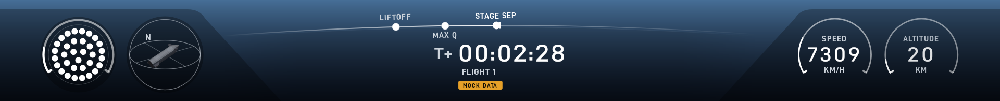
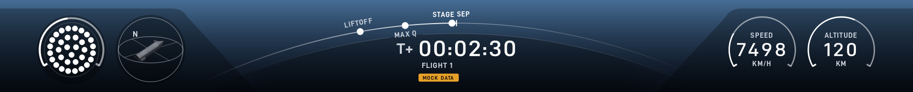
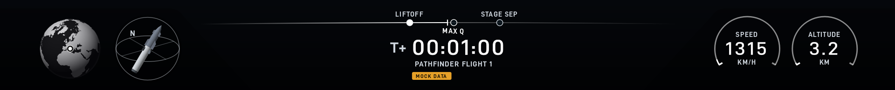
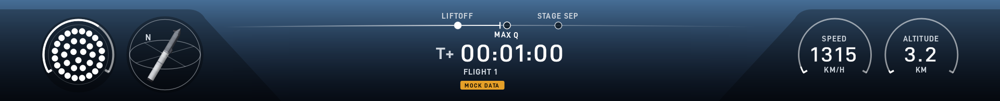
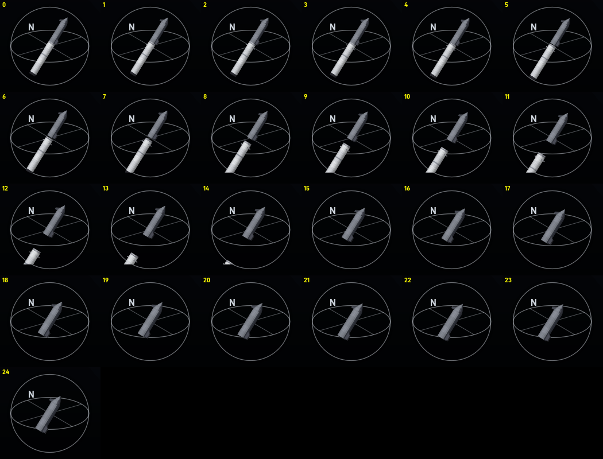
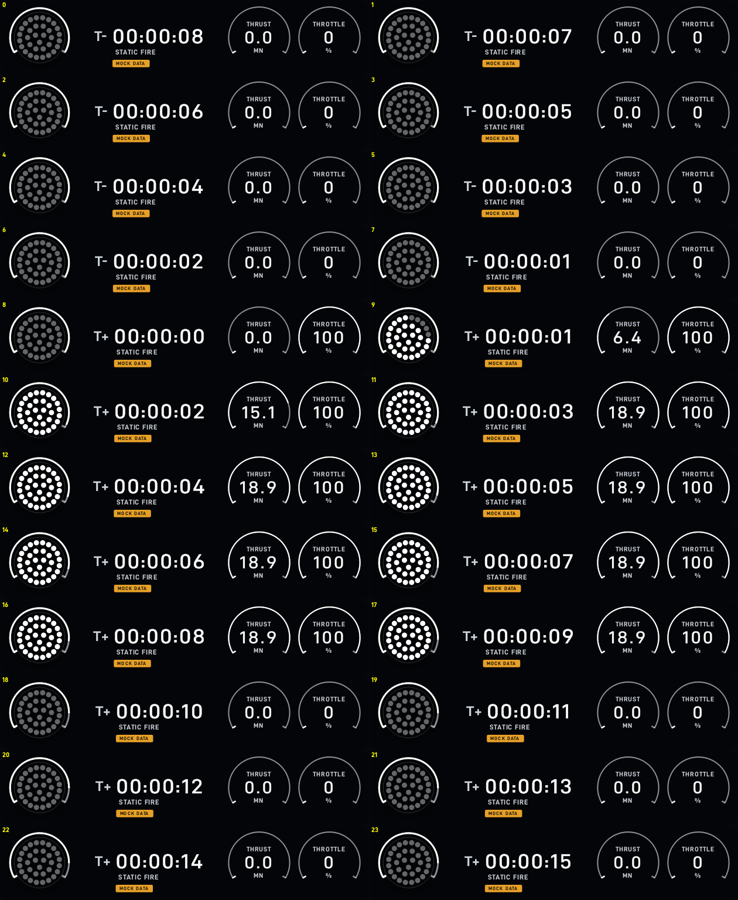
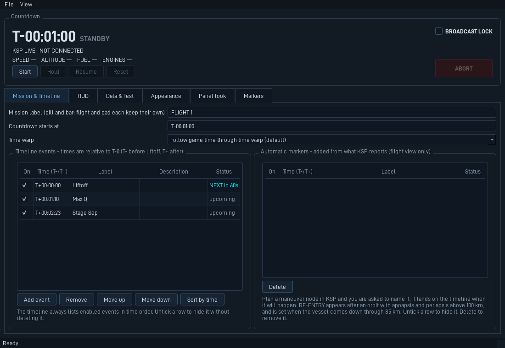

# KSP Starship Telemetry

A Starship-webcast-style telemetry overlay for Kerbal Space Program, fed by [kRPC](https://krpc.github.io/krpc/).
It shows the countdown clock, a curved flight timeline, engine dots with a propellant ring, a 3D attitude dial with a
Starship on its booster, speed and altitude, and a map, in the same arrangement as the real broadcasts. A control panel
for a second monitor runs it. **It only reads from the game: nothing here sends a flight command.**


## What it does

- **Launch bar.** Three arrangements that follow the flight: stage 1, stage separation, and flight. The real separation
  is detected from the data (the engine count changing), not just the planned time, and the 3D dial shows the booster
  dropping away.
- **Timeline.** Milestones scroll past the clock and the line bows with altitude, fully curved at 120 km. A milestone's
  dot turns white when it is passed. Add your own events and notes in the panel.
- **Automatic markers.** Plan a maneuver node in KSP and the panel asks you to name it; it lands on the timeline at the
  moment it will happen. A RE-ENTRY marker is added when you come down through 85 km, but only after an orbit with
  apoapsis and periapsis above 100 km.
- **Static-fire bar.** A small bar for the pad: engines, clock, thrust and throttle. It sits in the bottom-right corner,
  has no pill and no fades, and its clock runs on through T-0 (KSP's mission time stays at 0 on the pad).
- **Map.** A black-and-white Earth with your position, instead of the engine dial (key `M`).
- **Honest data.** Mock data is always labelled MOCK, and a lost or stale feed says so instead of showing old numbers.

| | |
|---|---|
|  |  |
|  |  |



The small static-fire bar through a made-up burn (mock data):




## Requirements

- Windows (the only system it has been run on), Python 3.11 or newer.
- Kerbal Space Program with the **kRPC** server mod (0.6.0) installed and started.
- For the 33-engine booster dial and thrust: the Starship Expansion Project (SEP) booster, whose engine cluster is a
  single part with a mode switch. Other rockets work, with the dial showing their engines.

## Run it

```bash
pip install -r requirements.txt
python run_ground_station.py
```

Start the kRPC server in KSP first. The app connects by itself when it opens and keeps retrying until the server is up
(accept kRPC's "allow connection" prompt in the game if it shows). No game at hand? In the **Data & Test** tab choose
mock data to watch a made-up flight.

The pill and bar are click-through, always-on-top windows meant for capture software or a screen; the panel is a normal
window. Untick click-through on the HUD tab to drag them. Settings are saved in
`%APPDATA%\KSP Starship Telemetry\settings.json`.

### Useful controls

| | |
|---|---|
| HUD tab, "Bar for" (or key `P`) | switch between the flight bar and the small static-fire bar |
| Key `M` | map instead of the engine dial (flight bar) |
| Mission & Timeline tab | the countdown, your events, the automatic markers (hide, rename or delete them) |
| Markers tab | stamp a typed note at the current time |
| HUD tab, 3D model | use your own `.glb`, `.gltf`, `.obj` or `.stl` rocket instead of the built-in Starship |
| Broadcast lock | locks every setting during a stream |



## Other scripts

- `python run_bar_demo.py` and `python run_pill_demo.py`: the bar or pill alone with mock data.
- `python run_live.py`: a bare live runner without the panel.
- `python render_previews.py` and `python render_sequences.py`: write pictures of every view into `previews/` and `images/`.
- `python -m pytest`: the test suite.

## Status

The launch bar, static-fire bar, engine dial (all four cluster modes), stage-separation detection, 3D dial, map and
timeline have been used in real launches and a static fire. The maneuver-node prompt and the RE-ENTRY marker are tested
with simulated data only and have not been flown yet.

## License and credits

Source-available, not open source: you may read it and run it for yourself, but not copy, redistribute or re-release it.
See [LICENSE](LICENSE). Fonts and map data keep their own licenses, see [THIRD_PARTY_NOTICES.md](THIRD_PARTY_NOTICES.md).

This is a fan-made tool, not affiliated with or endorsed by SpaceX, Squad, Private Division or Take-Two. "Starship" is a
trademark of SpaceX.
